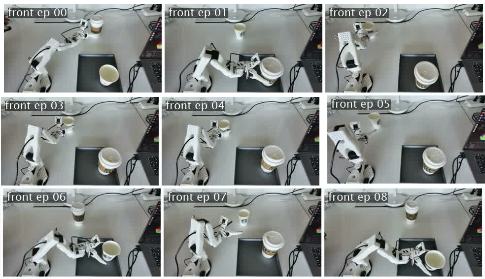
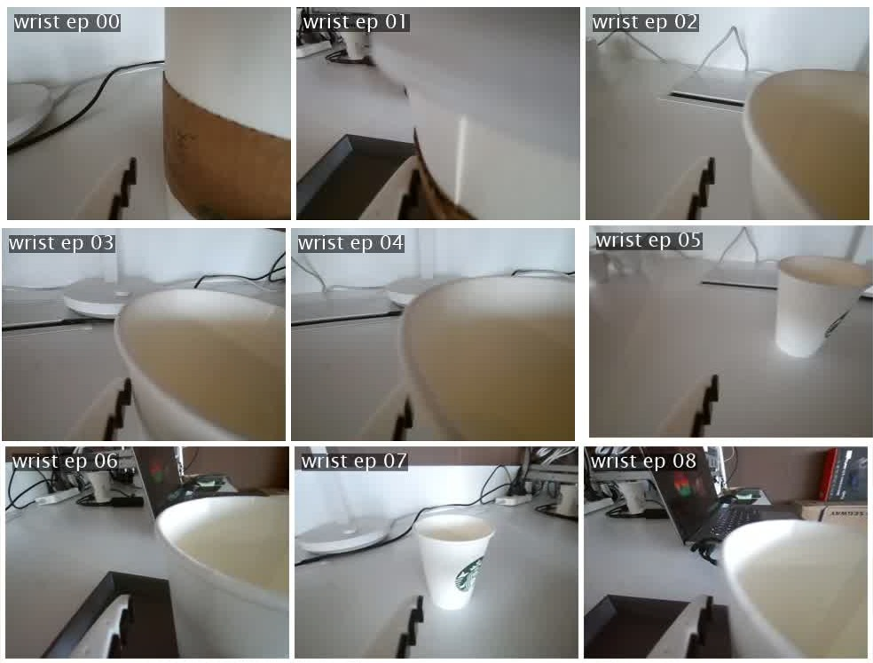

# Multimodal VLA Dataset Toolkit

[](https://huggingface.co/datasets/DerekLX/lerobot_derek_depth)
[](https://www.python.org/)
[](https://github.com/huggingface/lerobot)

This software project provides a multimodal VLA dataset toolkit for generating and auditing train-ready robotics datasets. It supports existing RGB-only datasets in the standard LeRobot ecosystem and RGB-D datasets with optional depth sidecars. RGB video is handled as a first-class data stream together with robot actions, states, metadata, and depth when available.

The toolkit is designed for Orbbec RGB-D collection, merging multiple same-structure LeRobot datasets into one real dataset, auditing RGB video/action/metadata quality with optional depth checks, building a cleaned copy from reviewed episode lists, and uploading the final dataset to Hugging Face.

It also includes separate LeRobot-side collection paths:

- `rgb_record/`: RGB-only recording overlay using the official Hugging Face LeRobot repository.
- `rgbd_record/`: Orbbec RGB-D recording overlay that can be copied into the official Hugging Face LeRobot repository.
- `visuo-tactile_record/`: visuo-tactile (vision + touch) recording overlay, in progress.

The official LeRobot project is here: https://github.com/huggingface/lerobot. The visuo-tactile data collection pipeline under `visuo-tactile_record/` is in progress, and its dataset and toolkit will be released open source when ready.

## Dataset

The merged RGB-D VLA dataset is available on Hugging Face:

```text
https://huggingface.co/datasets/DerekLX/lerobot_derek_depth
```

Repository:

```text
DerekLX/lerobot_derek_depth
```

The Hugging Face dataset root is intended to contain the LeRobot subdirectories directly:

```text
data/
depth_sidecar/
meta/
videos/
```

## Dataset Preview

The examples below are sampled from one `pick_up_cups_dataset` episode with two cups in the scene.


Left to right: global robot collection view, wrist camera view, and front depth visualization.

Task data collection:

<video src="assets/readme/task_demo.mp4" controls width="720"></video>

If the video does not render in your Markdown viewer, open [task_demo.mp4](assets/readme/task_demo.mp4) directly.

Aligned episode overview matrices:

| Front camera, 9 sampled episodes |
| --- |
|  |

| Wrist camera, 9 sampled episodes |
| --- |
|  |

| Front depth matrix, 9 sampled episodes |
| --- |
|  |

## Overview

Main capabilities:

- collect stock RGB-only LeRobot datasets through the official LeRobot recorder;
- collect Orbbec RGB-D data through a LeRobot overlay;
- merge multiple LeRobot-style datasets into one physical dataset;
- keep the output as real files, not junctions or symbolic links;
- rewrite episode indices, frame indices, task indices, metadata, parquet tables, video references, and depth sidecars;
- audit RGB-only LeRobot datasets and RGB-D datasets with depth sidecars;
- audit RGB videos, optional depth sidecars, action/state tables, metadata completeness, and deterministic quality failures;
- parse detailed task descriptions into validated, editable semantic profiles;
- run the local Task Semantic Studio for profile review and semantic audit setup;
- separate episodes into `keep`, `review`, and `drop` lists;
- build a clean train-ready dataset from `drop_episodes.txt`;
- upload the dataset to Hugging Face with resumable large-folder upload support;
- visualize depth PNG files for inspection.


## Getting Started

We recommend using a dedicated Python environment. Python 3.12 or newer is recommended if you also use the Orbbec RGB-D capture overlay.

Create and activate a conda environment:

```powershell
conda create -n vla_data_check python=3.12 -y
conda activate vla_data_check
```

Install Python dependencies:

```powershell
python -m pip install --upgrade pip
python -m pip install -r requirements.txt
```

Full video decoding and video trimming require `ffmpeg` and `ffprobe` command-line tools. If they are not already available in the environment, install them with conda:

```powershell
conda install -c conda-forge ffmpeg -y
ffmpeg -version
ffprobe -version
```

Enable faster Hugging Face uploads:

```powershell
$env:HF_XET_HIGH_PERFORMANCE="1"
```

## RGB Data Collection

Folder:

```text
rgb_record/
```

Purpose: provide a copy-in RGB-only recording overlay for the official LeRobot repository. This folder is separate from `rgbd_record/` because RGB-only collection should not depend on the Orbbec RGB-D overlay.

Use the official Hugging Face LeRobot repository directly:

```text
https://github.com/huggingface/lerobot
```

Copy the folder into a LeRobot checkout:

```powershell
$LEROBOT_ROOT="E:\path\to\lerobot"
Copy-Item -Recurse -Force .\rgb_record $LEROBOT_ROOT\
```

Install and find cameras from the LeRobot root:

```powershell
cd $LEROBOT_ROOT
python -m pip install -e ".[feetech,core_scripts]"
lerobot-find-cameras opencv
```

Record a head-camera + wrist-camera RGB dataset:

```powershell
python .\rgb_record\rgb_record.py `
  --config_path=.\rgb_record\configs\head_wrist_rgb_record.yaml
```

The output is a standard LeRobot RGB dataset with `data/`, `meta/`, and `videos/`. It should not contain `depth_sidecar/`. After recording, point this toolkit's merge, audit, clean, and upload scripts at the dataset root.

## Orbbec RGB-D Data Collection

Folder:

```text
rgbd_record/
```

Purpose: add Orbbec Femto Bolt RGB-D recording to a LeRobot checkout. This makes the pipeline cover capture -> merge -> audit -> clean -> upload.

Scope: this folder is for data collection only. It provides an Orbbec camera backend, RGB-D recording scripts, and depth sidecar storage helpers. It does not contain this project's depth model training or inference implementation.

The capture overlay is designed to be copied directly into the official Hugging Face LeRobot repository and used from there:

```text
https://github.com/huggingface/lerobot
```

Copy the overlay contents into the root of a `huggingface/lerobot` checkout. The target is the directory that contains LeRobot's own `pyproject.toml` and `src/lerobot/`.

Do not copy `rgbd_record/` as a nested subfolder under LeRobot. Merge its contents into the LeRobot repo root:

```powershell
$LEROBOT_ROOT="E:\path\to\lerobot"
Copy-Item -Recurse -Force .\rgbd_record\examples $LEROBOT_ROOT\
Copy-Item -Recurse -Force .\rgbd_record\src $LEROBOT_ROOT\
Copy-Item -Force .\rgbd_record\pyproject.toml $LEROBOT_ROOT\
```

After copying, the required files should appear directly under the LeRobot checkout:

```text
<lerobot_root>/examples/rgbd_vla_depth/
<lerobot_root>/src/lerobot/cameras/orbbec/
<lerobot_root>/src/lerobot/scripts/
<lerobot_root>/src/lerobot/robots/so_follower/
<lerobot_root>/pyproject.toml
```

Install inside the LeRobot repo root:

```powershell
cd $LEROBOT_ROOT
python -m pip install -e ".[feetech,orbbec,rgbd_vla]" -e .\examples\rgbd_vla_depth
```

Find the Orbbec camera:

```powershell
lerobot-find-cameras orbbec
```

Write the camera serial and robot ports into:

```text
examples/rgbd_vla_depth/configs/record_rgbd.yaml
```

Record:

```powershell
python .\examples\rgbd_vla_depth\record.py --config_path=.\examples\rgbd_vla_depth\configs\record_rgbd.yaml
```

Depth is saved as lossless uint16 PNG sidecars under `depth_sidecar/`, with a recording manifest at `meta/rgbd_vla_depth_recording.json`.

## Merge Datasets

Use `dataset_merge.py` to merge multiple `*_dataset` folders into one real LeRobot dataset.

```powershell
python .\dataset_merge.py `
  --src-root . `
  --out-dir .\lerobot_derek_depth `
  --dataset-glob "*_dataset" `
  --copy-mode copy
```

Overwrite an existing output:

```powershell
python .\dataset_merge.py --out-dir .\lerobot_derek_depth --overwrite
```

## Audit Dataset Quality

Use `data_quality_audit.py` to run conservative quality checks. Hard deterministic failures are marked as `drop`; suspicious but uncertain episodes are marked as `review`. The audit never deletes source data.

RGB is in scope. The audit checks RGB video existence, real-file status, empty files, ffprobe dimensions/codec when available, full ffmpeg decode when requested, and sampled black/white/near-constant/frozen video content. Existing RGB-only LeRobot datasets do not need a `depth_sidecar/` directory. When depth sidecars are present, the audit checks them separately through PNG structure, dimensions, optional full decode, invalid-depth ratio, and constant-depth samples.

```powershell
python .\data_quality_audit.py .\lerobot_derek_depth
```

Default audit output:

```text
quality_audit_reports/lerobot_derek_depth/
  quality_report.csv
  quality_summary.json
  keep_episodes.txt
  review_episodes.txt
  drop_episodes.txt
```

Run with video decode and sampled content checks:

```powershell
python .\data_quality_audit.py .\lerobot_derek_depth `
  --depth-check header `
  --video-check decode `
  --video-content-check sample `
  --sample-frames 8 `
  --depth-sample-frames 8
```

## Task Semantic Studio

Use the local task window to turn a detailed natural-language description into
a validated, editable semantic profile:

~~~powershell
python ./task_semantic_studio.py
~~~

Recommended workflow:

1. Enter the exact dataset task text in Dataset task text / name.
2. Write a detailed task description, including the ordered actions and final
   observable success state.
3. Select Parse description. The dependency-free local parser creates a draft
   containing objects, stages, observable conditions, and success/failure
   criteria.
4. Review the generated JSON. Add aliases when the dataset may use another
   exact task string, and set a calibrated review_threshold only when known.
5. Validate and save the profile into task_profiles/.
6. Select the dataset and evaluator plugin, then run the audit from the same
   window.

The local parser is deliberately conservative and its output is a draft. It
does not invent a confidence threshold. A stronger parser can be installed as
a module:attribute plugin and selected in the window without changing the
audit code.

Each saved profile contains:

- task_key, task_name, instruction, and aliases used for exact task matching;
- objects and attributes;
- ordered stages with observable video conditions and optional weights;
- final success and failure criteria;
- optional preferred_video_keys and a task-specific review_threshold.

The task name or one alias must match the task text referenced by the
episode's task_index. An episode containing multiple distinct task texts is
sent to review until it is segmented, rather than receiving one ambiguous
semantic score.

## Optional Semantic Quality Evaluation

The deterministic audit can optionally call a project-defined semantic
evaluator. The base installation does not download model weights and remains
fully usable when no evaluator is configured.

An evaluator receives the task text plus episode-scoped video files and their
start/end timestamps. It returns a normalized progress curve, a final success
probability, and optionally a named failure stage:

~~~python
class MySemanticEvaluator:
    name = "my_video_language_evaluator"

    def evaluate(self, episode):
        # Run an external or local video-language scoring model here.
        return {
            "progress_curve": [0.05, 0.30, 0.62],
            "success_probability": 0.41,
            "failure_stage": "grasp",
            "details": {"model_revision": "local"},
        }
~~~

Expose either an evaluator instance, an evaluator class, or a factory from a
Python module, then enable it with module:attribute syntax:

~~~powershell
python ./data_quality_audit.py ./lerobot_derek_depth --task-profile-dir ./task_profiles --semantic-evaluator my_quality_backend:create_evaluator --semantic-config ./semantic_evaluator.json --semantic-review-threshold 0.5
~~~

The evaluator configuration file is optional and must contain one JSON object.
Classes receive the object as keyword arguments; factories receive it as one
dictionary.

Semantic output is added directly to quality_report.csv:

- semantic_progress_curve_json
- semantic_progress_final
- semantic_success_probability
- semantic_score
- semantic_failure_stage
- semantic_status and semantic_evaluator
- semantic_task_profile and semantic_review_threshold

Success probability is used as the review score when provided; otherwise the
last progress value is used. A score below the configured threshold adds
semantic_low_score_review and never turns a trajectory into a hard drop.
Evaluator errors also go to review so model failures cannot silently approve
data. Episodes already marked drop by deterministic checks skip semantic
inference.

## Check Completeness

Use `utils/dataset_completeness_check.py` for structure-only validation after merging or cleaning.

```powershell
python .\utils\dataset_completeness_check.py .\lerobot_derek_depth
```

## Build a Clean Dataset

Use `dataset_clean_build.py` to create a new physical dataset from `drop_episodes.txt`. The original dataset is preserved.

Recommended workflow:

1. Run the quality audit.
2. Inspect `quality_report.csv` and `review_episodes.txt`.
3. Add manually confirmed bad episodes to `drop_episodes.txt`.
4. Build the clean dataset.

```powershell
python .\dataset_clean_build.py `
  .\lerobot_derek_depth `
  --drop-list .\quality_audit_reports\lerobot_derek_depth\drop_episodes.txt `
  --out-dir .\lerobot_derek_depth_clean `
  --video-mode trim-reencode
```

Notes:

- `trim-reencode` trims videos per kept episode and physically removes dropped episode segments.
- `copy-referenced` is faster, but copied mp4 files may still contain unreferenced old segments.
- The output includes `cleaning_manifest.json`.

## Upload to Hugging Face

Use `hf_push.py` to upload a local dataset directory to a Hugging Face Dataset repository.

Recommended token setup:

```powershell
$env:HF_TOKEN="hf_your_write_token"
```

The script also contains editable local defaults:

```python
HF_USERNAME = "your_huggingface_username"
HF_WRITE_TOKEN = "hf_your_write_token_here"
HF_DATASET_NAME = "your_dataset_name"
```

Always run a dry run first:

```powershell
python .\hf_push.py --dry-run
```

Upload:

```powershell
$env:HF_XET_HIGH_PERFORMANCE="1"
python .\hf_push.py
```

Upload a cleaned dataset instead:

```powershell
python .\hf_push.py `
  --dataset-dir .\lerobot_derek_depth_clean `
  --dataset-name lerobot_derek_depth_clean
```

## Visualize Depth

Use `depth_visualize.py` to inspect depth PNG statistics or generate visualization images.

Print statistics:

```powershell
python .\depth_visualize.py .\lerobot_derek_depth\depth_sidecar --stats
```

Generate visualization images:

```powershell
python .\depth_visualize.py .\lerobot_derek_depth\depth_sidecar --out .\depth_vis
```

## Run Tests

The repository includes a small synthetic LeRobot RGB-D dataset test. It does not use the real local datasets.

```powershell
python -m unittest discover -s tests
```

## Dataset Citation

If this dataset is useful for your work, please cite or link the Hugging Face dataset:

```bibtex
@dataset{dereklx_lerobot_derek_depth_2026,
  author    = {DerekLX},
  title     = {lerobot_derek_depth},
  year      = {2026},
  publisher = {Hugging Face},
  url       = {https://huggingface.co/datasets/DerekLX/lerobot_derek_depth}
}
```
